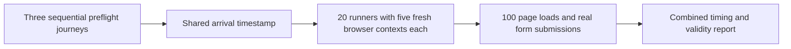

# 100 simultaneous waitlist browser users

Upload this standalone folder's contents to the root of a new **public GitHub repository** to run the test using GitHub Actions. Upload only this test harness. It requires no application source, application secrets, or database credentials.

GitHub's standard runners are free for public repositories. Public Linux runners provide four CPU cores and 16 GB RAM; GitHub Free allows up to 20 concurrent standard jobs. This workflow distributes 100 Chromium sessions across 20 runners, five sessions per runner. Other jobs on your account can reduce available concurrency.

- [Runner resources and public repository pricing](https://docs.github.com/en/actions/reference/runners/github-hosted-runners)
- [Concurrent job limits](https://docs.github.com/en/actions/reference/limits)



## Upload and run

1. Extract the provided ZIP. Create a new public GitHub repository and upload the extracted contents to its root, including `.github/workflows/waitlist-load.yml`. Do not upload the ZIP itself as the workflow. If browser upload skips `.github`, use **Add file → Create new file**, name it `.github/workflows/waitlist-load.yml`, and paste the bundled workflow.
2. Under **Settings → Secrets and variables → Actions → Repository secrets**, add:

   | Secret | Value |
   |---|---|
   | `TEST_EMAIL_STEM` | The email text before its counter and `@`, for example `mytestuser` |
   | `TEST_EMAIL_DOMAIN` | Email domain, for example `gmail.com` |
   | `TEST_PHONE` | Your authorized 10-digit test phone number |

3. Open **Actions → Waitlist browser burst → Run workflow**. Keep the URL `https://www.fromthetop.in/` and email start number `1` for the first run.
4. The workflow checks three journeys sequentially without submitting. If their form behavior is correct, it prepares 20 runners and gives them the same arrival timestamp eight minutes ahead.
5. Download `combined-report` from the completed workflow. Read `report.md`; JSON contains per-user measurements, host CPU/free RAM samples, JavaScript errors and failed network requests. `cleanup-emails.txt` lists the email addresses whose signup POSTs were sent; their acceptance status is in JSON. Retention is one day. Artifacts can contain these test addresses, so use only authorized test details.

The burst creates real signup requests and notification emails. Increase the email start number by 100 for subsequent runs if prior entries have not been removed; duplicate emails exercise the duplicate path instead of a fresh signup.

## Journeys and measurements

| Count | Journey | Expected submitted consent |
|---:|---|---|
| 34 | Name and email only | `false`, no phone |
| 33 | Name, email, phone; verify consent automatically checks | `true` |
| 33 | Name, email, phone; verify consent automatically checks, then uncheck it | `false` |

All 100 sessions start navigation at the shared timestamp. Each is a fresh browser context with a cold browser cache. Sessions fill the form after their own page becomes ready; they do not synchronize the submission clicks.

Page readiness includes scrolling through the page to trigger lazy images, waiting for HTML image elements and fonts, and bringing the form into view. Every user's readiness must be within five seconds. Typing uses actual keyboard events with deliberate character delays totaling approximately 1.1 seconds; automation overhead is included in the fill duration, which must be at most two seconds. A faster fill waits until the two-second mark before clicking.

The script also measures click-to-success time and verifies HTTP 202, the accepted response body, the visible success heading, and the exact submitted phone/consent values. No click-to-success pass threshold is invented; it is reported separately. Event Timing and long tasks are diagnostics, not a complete field INP measurement.

The combined report marks a burst **INCONCLUSIVE** if fewer than 100 unique users are recorded, their actual navigation starts span more than one second, or the runner samples detect CPU above 90%, free RAM below 1 GB, or event-loop p95 delay above 100 ms. A missed start makes that shard stop instead of submitting late. Clock skew between runners, unmeasured resource spikes and runner network/location remain measurement limitations. A functional or timing failure in a complete burst without those warnings is **FAIL**.

GitHub-hosted locations and desktop Chromium are not a measurement of Indian mobile network performance. Keep device/network settings fixed when comparing runs.

## Local use

Requires Node.js 22 or later. From this folder:

```powershell
npm ci --ignore-scripts --no-audit --no-fund
npx playwright install chromium
npm run preflight
```

Preflight never clicks submit and uses one browser context at a time. To use an installed Google Chrome locally, set `$env:BROWSER_CHANNEL = 'chrome'` before preflight.

For a burst, set `EMAIL_STEM`, `EMAIL_DOMAIN`, `TEST_PHONE`, and optionally `EMAIL_START`, then run `npm run burst`. Do not run the 100-browser burst on the current low-memory PC. For a single-machine 100-session test, **32–64 GB total RAM is a planning estimate**, with 64 GB a safer starting point; CPU and bandwidth also need measuring. Actual needs depend on the page and Chromium usage. This script's free-memory guard is a coarse safeguard, not a proven capacity requirement. The distributed workflow avoids placing all 100 sessions on one machine.
